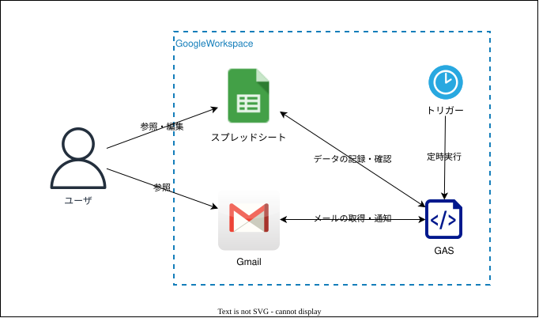
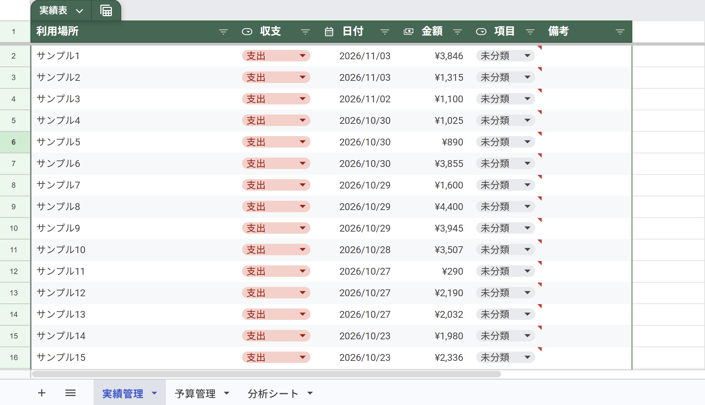
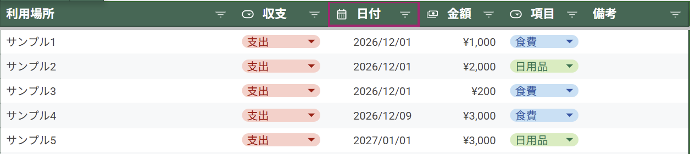
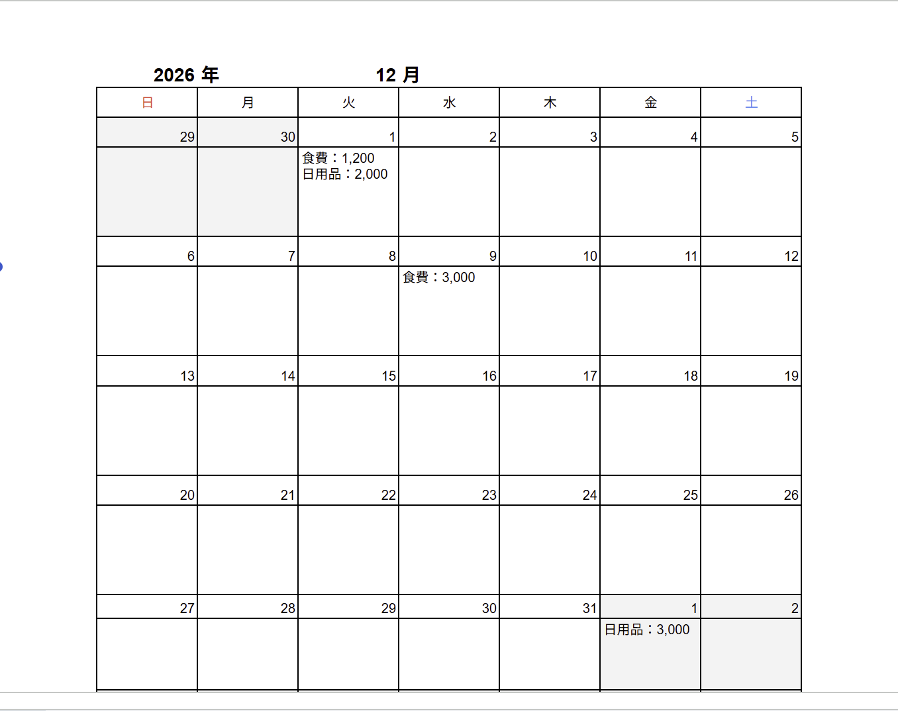
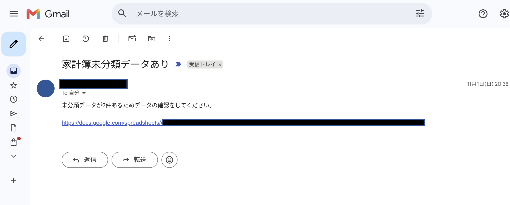

# 家計管理

## 1. 目的
Googleスプレッドシートを利用した家計簿管理を自動化する。  
Gmailに届くクレジットカードの利用通知メールから情報を取得し、
スプレッドシートへ自動登録する。また、特定の時刻までに利用項目の分類が完了していない場合はメールで通知する。

これらの機能によって、家計簿の入力作業を簡略化し、継続的な家計管理の習慣化を目指す。

## 2. 開発環境
- 開発言語：JavaScript（Google Apps Script）
- 実行環境：Google Apps Script
- 使用ツール：Google スプレッドシート

## 3. 実装機能
- 利用履歴の自動登録
    - Gmailからクレジットカードの利用通知メールを取得
    - メールから[利用日, 利用場所, 利用金額]を抽出
    - 抽出した情報をスプレッドシートへ自動登録
- 未分類項目の通知
    - スプレッドシートに登録された利用履歴を確認
    - 未分類の項目が存在する場合、メールで通知

## 4. トリガーの設定
| 実行頻度 | 処理内容 |
| --- | --- |
| 1時間おき | Gamilからクレジットカード利用通知メールを取得し、未登録の利用履歴をスプレッドシートへ追加
| 毎日20時~21時 | 未分類の項目が利用履歴に存在する場合、メールで通知 | 

## 5. 構成図

    

## 6. 画面イメージ
### 利用履歴保存画面

    

### 日付ごとの利用履歴確認
登録された利用履歴を日付ごとに集計し、各項目の合計金額を表示する。  
これにより、いつ・何に・いくら使用したかを確認できる。

    
    

### 未分類項目の通知
利用履歴に未分類の項目がある場合は件数をGmailにてリンク付きで通知する。

    

## 7. 学習内容
### GAS
- GASからGmailのスレッドを取得方法
- GASによるスプレッドシードの操作
- GASのスクリプトプロパティを利用した設定値の管理

### スプレッドシート
- LET関数による変数の定義
- MAP関数による配列処理