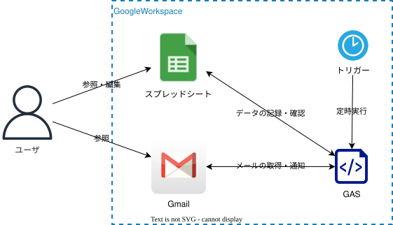

# Finance Automation

## 1. 目的
家計簿管理をスプレッドシートで管理を行う。 
クレジットカードの利用履歴メールから内容を読み取りスプレッドシートへの自動登録を行い、特定の時間までに分類分けが出来ていなければ通知を行い、家計管理簿を付ける作業を簡略化する

## 2. 開発環境
- 開発言語：JavaScript（Google Apps Script）
- 実行環境：Google Apps Script
- 使用ツール：clasp、Google スプレッドシート

## 3. 実装機能
- Gmailに届くクレジットカード利用履歴から[利用日, 利用場所, 利用金額]を取得し、スプレッドシートに追加する
- スプレッドシートした情報で項目が未分類の項目があった場合は、メールにて未分類がある旨を通知する

## 4. トリガー
- 毎日、午後20時から午後21時にスプレッドシートに追加した記録に未分類が存在するかチェックし通知する
- 1時間おきにGmailからクレジットカードの利用履歴を取得し、未追加のものをスプレッドシートへ追加する

## 5. 構成図

## . 学習内容
- GASからGmailのスレッドを取得方法
- GASを使用してのスプレッドシードの操作
- GASプロジェクトに環境変数を登録して利用
